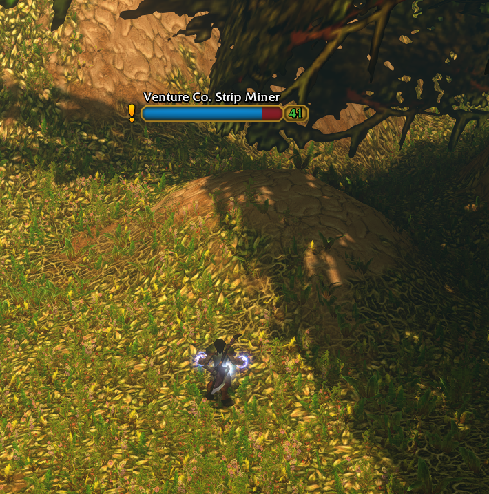
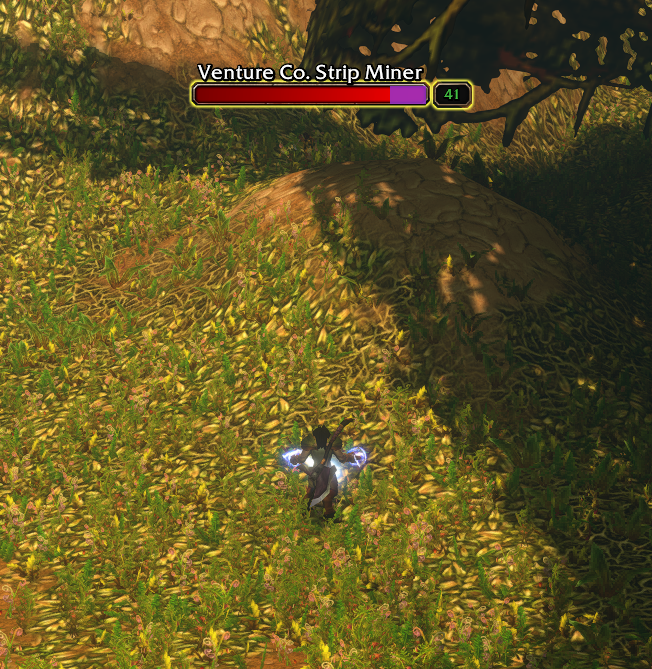
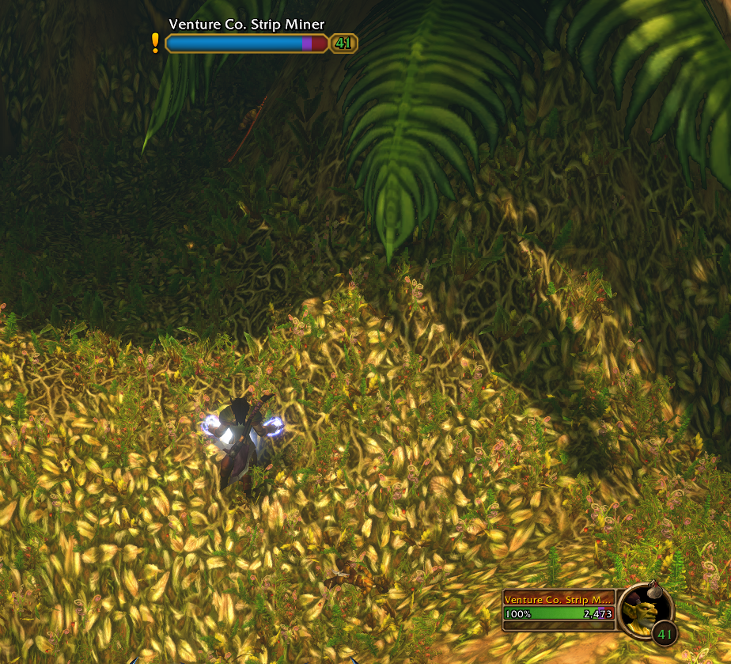
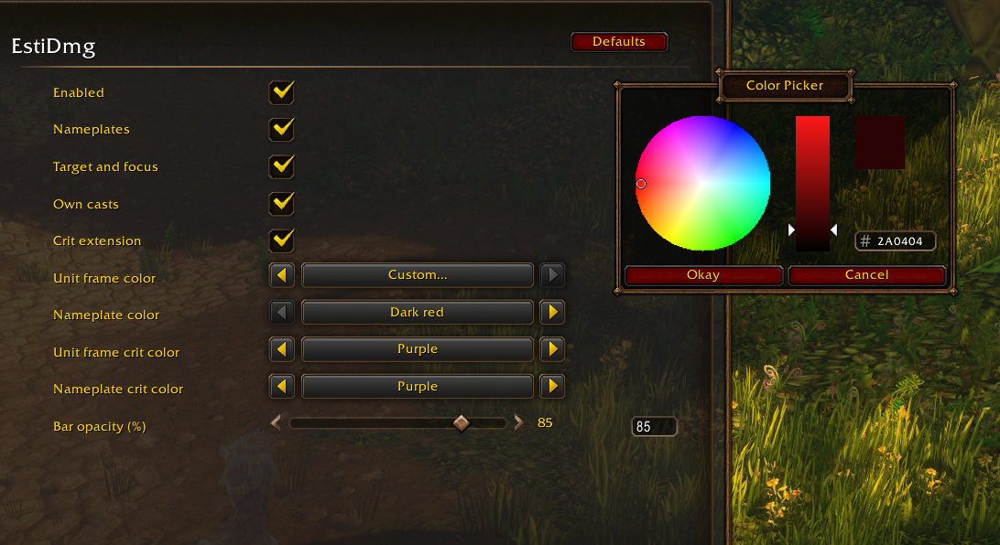
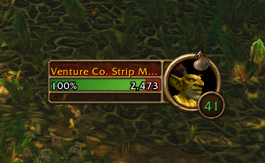

# EstiDmg

Marks the estimated damage of casts on enemy health bars, like Estimated Heals does for incoming heals.

## Features

- **Damage bar** - a red part of the health bar shows the expected health loss while an enemy casts a damaging spell.
- **Own casts** - your own cast shows its damage on your target.
- **Nameplates, target, focus** - each can be switched off separately, as can own casts.
- **Crit extension** - optional extra bar part in front of the damage bar for a possible crit of your own cast, including crit damage talents (Elemental Fury, Ice Shards, Ruin, Vengeance), in its own color.
- **Bar colors** - pick a preset color, or optionally any color with the color picker, separately for unit frames and nameplates (dark red by default), and set how solid the bar is in percent, with a slider or a command.
- **Other UI addons** - tested with Platynator; it may work with other unit frame and nameplate addons.
- **Localization** - settings page and status messages in German on German clients, English everywhere else; slash commands stay English.
- **Remembered** - settings are saved per account, or per character with one checkbox;
  default is on.
- **Settings page** - all options in the game menu under Options > AddOns, also opened
  from the addon compartment menu.
- **Chat commands** - every option can also be changed by slash command.
- **Test** - draws a sample estimate on your target to check colors and placement.

Limits: the bar uses the first damage value in the spell's description, so it is a rough estimate. Spells without a damage number show nothing. Where the game hides enemy spell IDs, nothing is shown either. The crit part knows only the listed Classic-era talents, found by their English name, and assumes the base spell crit bonus of 50%.

## Screenshots

Damage bar on a nameplate while casting:



Free bar color on a nameplate:



Crit extension in its own color in front of the damage bar:



Settings page with the color picker:



Target frame:



## Install

1. Download `EstiDmg-vX.Y.Z.zip` from the
   [releases](https://github.com/tf4482/EstiDmg/releases) (or CurseForge).
2. Unzip it into `World of Warcraft/_forever_/Interface/AddOns/`.
3. Restart the game or type `/reload`.

## Usage

```text
/estidmg                         show the current state
/estidmg on                      turn the estimates on
/estidmg off                     turn the estimates off
/estidmg nameplates on|off       mark the damage on enemy nameplates
/estidmg frames on|off           mark the damage on the target and focus frames
/estidmg own on|off              show the damage of your own cast on your target
/estidmg crit on|off             add the crit extension to your own cast
/estidmg color frames red        set a preset color (darkred, red, orange, purple, blue, black)
/estidmg color plates            pick a free color for nameplates
/estidmg color critframes        pick a free crit color for unit frames
/estidmg color critplates orange set the crit color for nameplates
/estidmg opacity 70              set the bar opacity in percent
/estidmg character on            use settings for this character only
/estidmg character off           use the account settings again
/estidmg test                    draw a sample estimate on your target
/estidmg reset                   reset the settings to defaults
/estidmg debug on                show what the addon does, until /reload
/estidmg config                  open the settings page
/estidmg help                    list all commands
```

## Examples

- Just play: it is on by default, so watch the bar on a caster's nameplate.
- Only want the target frame: open `/estidmg config` and untick Nameplates.
- See what your big spell will do: target an enemy and start casting, the bar shows the expected loss.
- Quick switch off in a dungeon: `/esd off` (`/edmg` works too).
- Check your colors without a caster: target an enemy and type `/esd test`.
- Different colors on your healer: `/esd character on`, then pick the colors there.

## Develop

Check the code with [Luacheck](https://github.com/lunarmodules/luacheck) before each commit
(CI runs it on every push):

```text
luacheck .
```

Deploy locally: run `deploy.bat`; it builds `release/EstiDmg-vX.Y.Z.zip` from `VERSION`.

Release: set `VERSION` to `X.Y.Z`, then push an annotated tag `vX.Y.Z`; GitHub Actions
packages the addon with the BigWigs packager and publishes it.

## License

All rights reserved, see [LICENSE](LICENSE).
